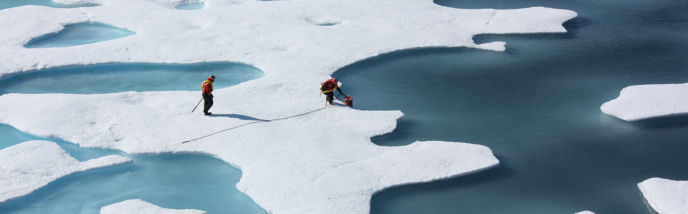

::::{grid} 1 1 1 1

_Photo: NASA/Kathryn Hansen_

::::

::::{grid}  1 1 2 2

:::{grid-item-card} Instructor Team
👤 [Carl Boettiger](https://carlboettiger.info), instructor  
👤 [Daniela Rodriguez-Chavez](https://nature.berkeley.edu/people/daniela-rodriguez-chavez), GSI, drodriguezchavez@berkeley.edu  
👤 [Elizabeth Ruiz](https://ourenvironment.berkeley.edu/people/elizabeth-ruiz), GSI, elizabeth.ruiz@berkeley.edu
:::

:::{grid-item-card} Logistics
🏛 Wheeler 212  
📅 Wed/Fri 8-10am  

**Office hours**  
Carl: [Fri 12pm](https://berkeley.zoom.us/my/cboettig) on Zoom  
Daniela: Tue 11:10am-12:50pm, Wellman 315  
Elizabeth: [Thu 10am-12pm](https://berkeley.zoom.us/j/92961453385) on Zoom  
Each of us also meets by appointment.
:::

::::

ESPM-157 seeks to introduce students to cutting-edge skills in data science and computer coding, including GitHub,
reproducible notebooks, databases, data visualization, geospatial analysis and more in an inclusive and hands-on
collaborative setting. See our syllabus and overview (links below or on the side menu). _Please see_ the enrollment section on the syllabus if you questions about getting into this course!

## Links

- [Course DataHub](https://nature.datahub.berkeley.edu) 
- [Course Forum (Zulip)](https://espm-157-f26.zulipchat.com/)
- [Course GitHub](https://github.com/espm-157)

